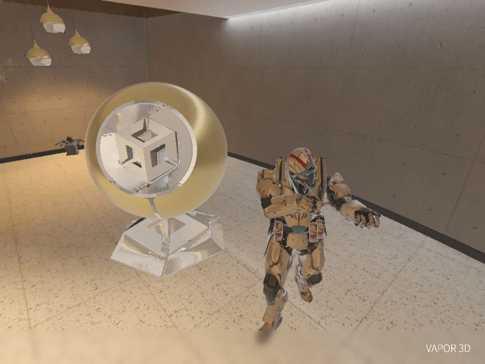
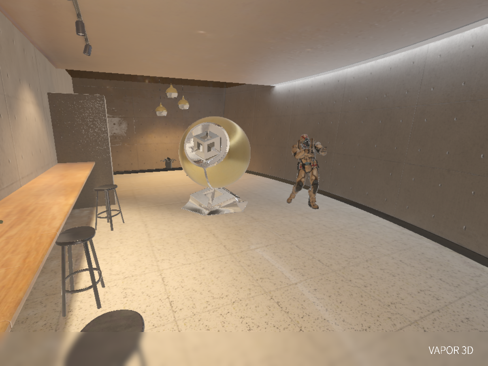
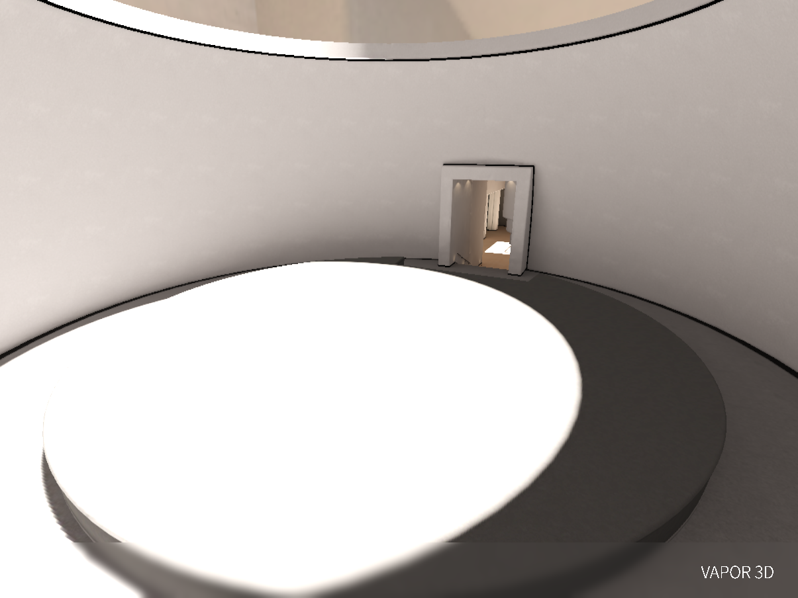
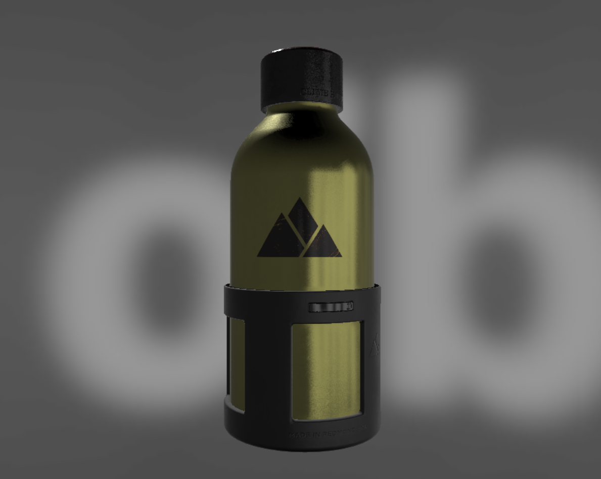
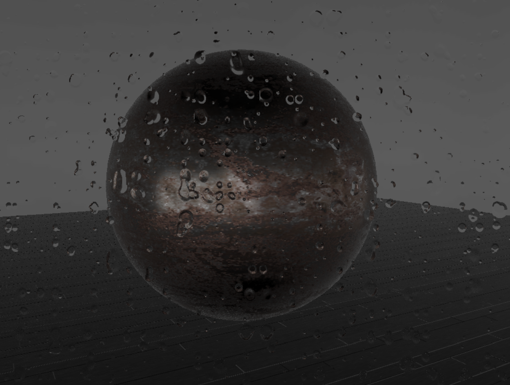
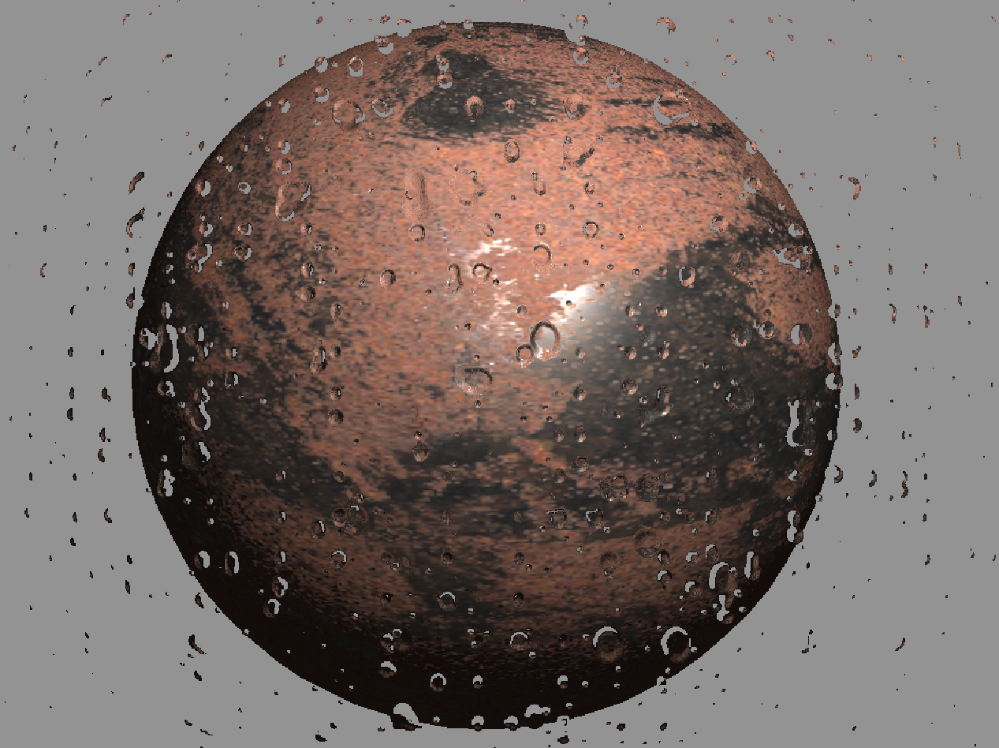

# Vapor 3D Engine

高性能、可编程的 WebGL2 3D 框架。

---

> **TODO**: 扩展处于测试阶段，遇到问题欢迎向我反馈。文档目前仅为大纲，将来有时间会来完善。

---

## 待办事项：
- [X] 延迟渲染
- [X] GLB Loader
- [X] Physically Based Rendering
- [X] AABB Parallax-Corrected IBL
- [X] Ping-Pong 双缓冲后处理
- [X] Scene Graph & Node Tree
- [X] Skinning Animation via Matrix Stream Texture Upload
- [X] Multi-animation blend & bone mask
- [ ] Shadowmap
- [X] Pre-baked Global Illumination
- [ ] Bloom
- [ ] TAA

## 渲染效果

* 可前往 example/ 查看我最近在写的一些二次开发作品，均采用MIT开源

---
<small>
<b>Credits:</b>
 PBR textures: FreePBR.com; IBL prefiltered textures: cmftStudio; Water Bottle model: Khronos Group (CC BY 4.0); BRDF LUT: LearnOpenGL (CC BY-NC 4.0); Vanguard character model: T. Choonyung via Mixamo.com.
 This project also uses <b>gltf-loader-ts</b>.
 The Unity HDRP Sample Scene is used for rendering tests and compatibility checks. Its assets belong to Unity and are not included for redistribution.
 Vapor3D is an open-source research and learning project licensed under <b>MPL 2.0</b>. Third-party assets remain the property of their respective owners and are subject to their original licenses.
</small>

**By: Joy_Ful** | License: MPL-2.0
